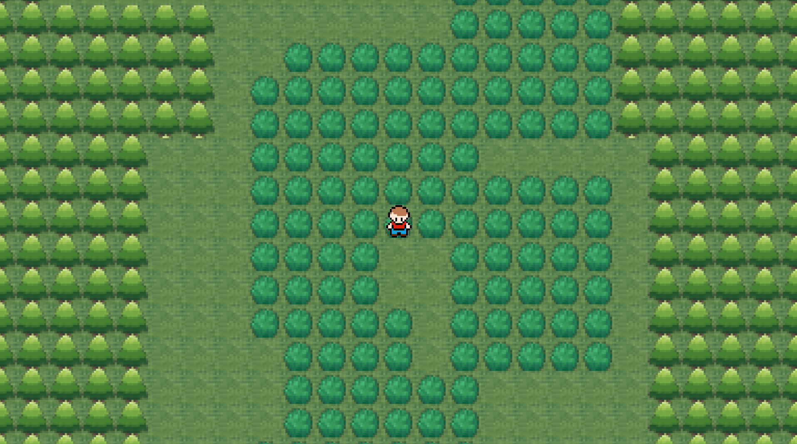

# Procedural Terrain Generator and JavaFX Framework

A procedural 2D terrain generator built on a reusable framework I developed
in Java and JavaFX. The project combines terrain generation, scene management,
character movement, animation, camera tracking, collision regions, and triggers.

Originally developed in September–November 2023, with Java 25 maintenance in 2026.



## Features

- Layered procedural terrain assembled from randomized grids.
- Reusable scene and game-object components.
- Character movement and directional animation.
- Camera tracking.
- Collision boundaries and trigger regions.
- Cached tile strips and image composition for terrain rendering.

## My contribution

This is a solo personal project. I implemented the terrain-generation logic
and reusable framework components, including scene and object management,
camera tracking, character controls, animation, collision regions, and triggers.

I consulted online technical references for specific implementation problems,
including image composition. 

## Run locally

### Requirements

- JDK 25
- Apache Maven
- An environment capable of running desktop JavaFX applications

### Download and launch

```bash
git clone https://github.com/deadlife1499/javafx-procedural-terrain.git
cd javafx-procedural-terrain
mvn clean javafx:run
```

Maven downloads the dependencies declared in pom.xml.

### Tested environment

- Operating system: Windows 11
- JDK: 25.0.4.1
- Maven: 3.9.12

### Controls

| Input | Action |
| --- | --- |
| W / A / S / D | Move |
| Hold Shift | Run |

## Architecture

| Component | Responsibility |
| --- | --- |
| Window | Application startup and initialization |
| SceneManager | Scene registration and switching |
| MainLevel | Terrain generation and environment construction |
| GameObject | Visual objects, layers, and interaction regions |
| ObjectHandler | Object registration and rendering order |
| Camera / CameraHandler | Camera selection and scene positioning |
| Player | Input, movement, animation, and collision checks |
| BackgroundProcesses | Scene-specific update callbacks |
| Collider / Trigger | Rectangular interaction regions |

## Performance work

The terrain initially required many individual visual objects. I introduced
cached tile strips and combined tiles into larger images using BufferedImage
and SwingFXUtils, reducing the number of separate objects needed.

During development, I observed loading improve from over a minute to seconds.
This was an informal observation, not a controlled benchmark.

## Testing

The project has been tested manually. Checks include launching from a clean
build, character movement, camera following, and collision behavior.

## Known limitations

This is a personal learning project. Some components are experimental,
and no automated test suite is currently provided.
